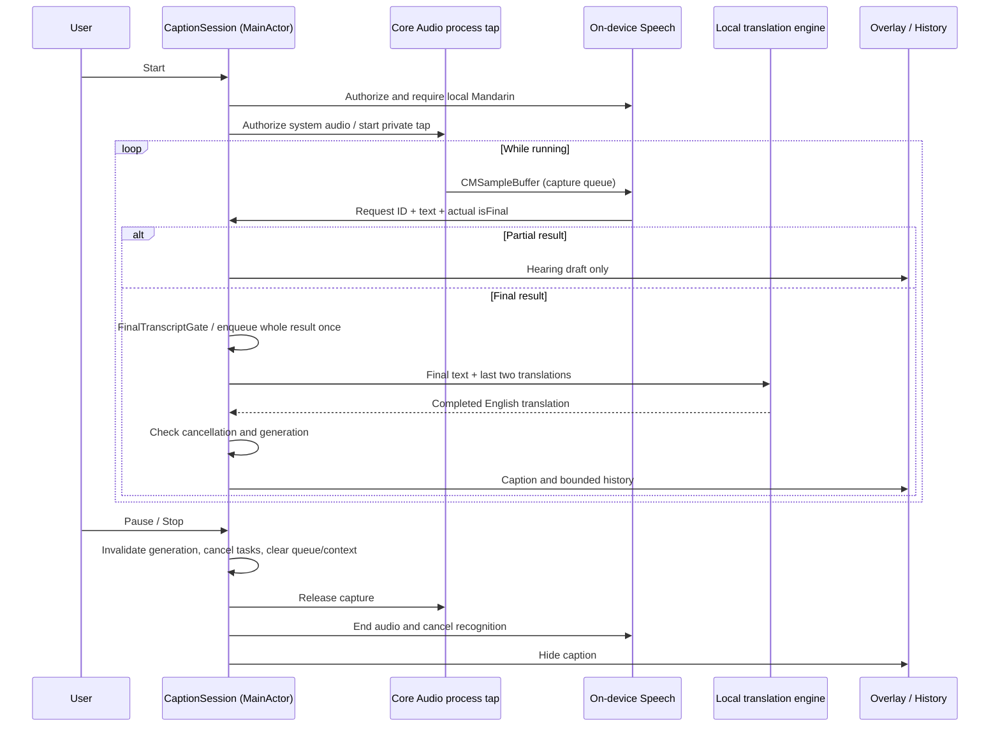

# Architecture

ImmersionCaption uses a small MVVM-style presentation layer with a dedicated application coordinator and replaceable infrastructure adapters. The minimum runtime is macOS 14.2, which provides Core Audio process taps and system-audio-only authorization. Swift 5.9 is the minimum app compiler; the Foundation-only domain package also supports the initially installed Swift 5.3 tools.

## Responsibilities and dependencies

[Open the full-size SVG](docs/diagrams/architecture.svg) · [PNG](docs/diagrams/architecture.png) · [Editable Mermaid source](docs/diagrams/architecture.mmd)

This is a component map, not a runtime sequence. Solid arrows show existing calls, observations, or policy dependencies. Each provider box pairs an application protocol with its current infrastructure adapter. The dashed arrow and gray section show the planned embedded replacement; they are not implemented. AppContainer assembles the current providers and settings and defers overlay creation until view startup. The sequence diagram below shows the actual audio-to-caption flow.

- **CaptionCore** has no UI, HTTP, Speech, Core Audio, Combine, or dependency on Ollama's transport. Its `TranslationPrompt` is a named TranslateGemma policy helper; other translation models can ignore it. Values and bounded queues remain provider-neutral.
- **Application/Ports.swift** defines `SystemAudioCapturing`, `SpeechRecognizing`, and `TranslationEngine`. Capture and speech exchange native `CMSampleBuffer` audio; the capture adapter copies HAL buffers into owning sample buffers without resampling. That boundary is intentionally macOS-specific; replaceable speech adapters must accept or convert these buffers. Transcript events carry a request ID, cumulative text, and the recognizer's actual final flag. Timings and native recognition types do not cross this boundary; the application never reconstructs a finalized result from drafts. Translation values remain backend-independent.
- **CaptionSession** is the use-case coordinator and observable view model. It owns lifecycle, final-result gating and duplicate tracking, translation ordering, history, context, overload reporting, caption expiry, and cancellation.
- **Infrastructure/Audio** owns `CoreAudioTapCapture`: a private, unmuted global stereo process tap and a private aggregate containing only that tap. `NSAudioCaptureUsageDescription` requests system audio access. There is no display enumeration, ScreenCaptureKit dependency/fallback, physical input device, or microphone input. The existing HAL process object is excluded when available; this app produces no playback. The adapter reads the tap’s native PCM format and copies callback memory with `PCMBufferConverter`. A format-change listener stops the session if the format changes; unchanged notifications are ignored.
- **Infrastructure/Speech** manages local Mandarin recognition, graceful request finishing, synchronized audio append, and a bounded audio handoff buffer. Runtime capability is checked before recognition; `requiresOnDeviceRecognition` is always true.
- **Infrastructure/Translation** owns Ollama JSON, HTTP timeouts, loopback restriction, redirect rejection, completion validation, and error mapping. It does not choose UI state or store history.
- **Infrastructure/Persistence** stores appearance and backend preferences in UserDefaults. History and audio are not automatically persisted.
- **Presentation** observes session/settings. Its click-through panel handles Spaces/fullscreen positioning separately from the content views. Views invoke coordinator methods and do not construct inference adapters.
- **AppContainer** assembles concrete dependencies once. A view task creates the overlay after dependency resolution has finished, avoiding nested hosting-graph creation during SwiftUI StateObject initialization. It retains that overlay even when the main window is closed. The menu bar remains usable.

There is one source-level app module and one local domain package. More packages, repositories, generic pipeline frameworks, or an unused model-manager abstraction would add little value at this stage.

## Data flow

## Concurrency and ownership

Presentation, settings, coordinator, and capture entry points are MainActor-isolated. Each `AudioTapRun` confines native setup/teardown and resource IDs to a serial control queue, keeping permission/device calls off MainActor. Core Audio invokes a separate serial sample queue synchronously. `PCMBufferConverter` copies HAL-owned interleaved or planar PCM into owning `CMSampleBuffer` data before the callback returns, retaining the native sample rate/channel format and advancing frame-based timestamps. A lock-protected `AudioTapOutput` serializes delivery with disable. `SpeechAudioSink` serializes append/endAudio, session-token checks, and ordered replay of its bounded in-memory audio handoff buffer. There is no unbounded task stream or disk audio storage. Conversion and format errors hop to MainActor once; stop suppresses queued failure delivery.

Apple recognition callbacks snapshot text/finality and dispatch onto MainActor. Session and request UUIDs reject callbacks after stop or after a request has completed and been replaced; a finishing request remains valid until its real final callback or failure. Session generation UUIDs reject translation results after pause, stop, failure, or restart, including providers that ignore cancellation. Transition counters prevent new starts during pending startup/teardown. The capture adapter has its own generation to handle cancellation during asynchronous setup/teardown. Stop disables delivery immediately, then stops/destroys the IOProc, removes the format listener, destroys the aggregate, and destroys the tap on the control queue. Partial startup failures follow the same cleanup path. Run resources are never reused by a later session.

One worker Task translates sequentially so context is ordered. At most three additional phrases wait; dropping the oldest pending phrase preserves newer dialogue at the expense of completeness. The caption-expiry Task is replaced/cancelled as appropriate; there is no stable-draft translation timer. A failed backend visibly stops the pipeline; there is no retry storm or cloud fallback.

## Final-result policy and latency

`CaptionSession` always updates the Hearing preview from recognition events, but only `isFinal == true` can pass `FinalTranscriptGate` into the translation queue. The gate accepts the whole finalized text once, trimming surrounding whitespace only, and remembers up to 128 completed IDs. The native adapter additionally rejects retired-request callbacks. Tracking resets with the session. Different request IDs can contain the same spoken words; no global text deduplication is performed. Manual Translate sample is an explicit text-only path outside the speech gate.

The previous `TranscriptSegmenter`, `TranscriptCursor`, and `SpeechSegment` types and their draft-alignment paths were removed. No partial punctuation, character count, word timing, duration, pause, or draft-stability timer creates translation work. There is no cross-request concatenation of draft text. Finalized input can contain several sentences and is sent intact.

The Apple adapter retains partial reporting solely for Hearing and maps the native `result.isFinal` unchanged. At 45 seconds it ends the current request's input through `SpeechAudioSink.beginFinalization()` and calls `SFSpeechRecognitionTask.finish()`; it keeps the same request/session token alive while waiting for the actual final callback. It starts a new request only after that callback, preserving final-result order. Finalization has a 10-second deadline; a missing final or native error stops the session rather than translating a draft.

During finishing, capture continues into `SpeechAudioSink`'s owning PCM buffer (maximum 12 seconds / 2,048 sample buffers). Under the same lock, the next request receives those buffers in capture order before subsequent live samples. Session tokens prevent old receivers from appending into a restarted session. Invalid sample timing or overflow reports failure once; stop clears all queued audio. Only one native recognition request is active at a time, avoiding parallel-recognizer resource contention. The handoff is bounded and stays in memory; no audio is saved or played back to the user.

This deliberately trades latency for settled recognition: the first caption can wait roughly 45 seconds plus finalization/inference unless Apple finalizes sooner. `isFinal` indicates completed recognition, not semantic completeness or guaranteed word accuracy. Graceful native finalization and continuous handoff still require real-audio validation. Long finalized segments can exceed the model's context/output limits or the bounded subtitle panel; pagination and model-context management remain future work.

Domain tests exercise final gating, full-input fidelity, duplicate tracking, empty finals, legitimate repeated speech, and session reset. App tests cover revised draft preview without translation, final-only history/context, lifecycle races, and bounded audio buffering/replay/stop behavior. Non-streamed translation responses are published only when completed; recognition finality and model response completion are independent checks.

## Translation policy

The current adapter uses TranslateGemma's documented single user message, Chinese `zh-Hans` → English `en`, and its source separator. Guidance prioritizes natural conversational English, idiom meaning, tone, fidelity, and no added facts. Two previously translated pairs provide limited context, explicitly separated from the current source. The prompt requests one translation of the current fragment, no alternatives or repetition of context, no invented continuation, and preservation of narrative subjects. Temperature is 0 to reduce sampling variation; context changes and backend differences can still change wording. Output is accepted only after a complete nonempty response; token-limit truncation is an error. One response can legitimately contain multiple English sentences; it always creates just one caption entry.

Context can help ambiguous words but also propagate earlier mistakes. It is cleared on lifecycle transitions and when history is cleared. There is no claim that prompting guarantees semantic fidelity or native fluency. Human-reviewed regression fixtures record real weaknesses.

## Privacy boundary

The app does not configure a microphone and registers no microphone stream output. It never opens a screen-capture stream, stores no raw audio, and retains at most 300 captions in memory. History export is user initiated. Logs describe lifecycle/failure categories only, not recognized or translated content.

The Ollama adapter accepts explicit HTTP loopback URLs, disables proxy configuration, and rejects redirects. This confines the application's HTTP transport; a locally configured server could itself forward data. Users must run trusted Ollama with a genuinely local model. Initial setup/model downloads can require internet. Offline operation requires both Apple's language assets and the translation weights/runtime to be available beforehand.

## Replacing AI engines and becoming standalone

1. Implement `TranslationEngine.translate(_:)` using a compatible embedded runtime. It receives a provider-neutral source/context value and returns English, honoring cancellation. Put model-specific prompts/tokenization inside that adapter.
2. In AppContainer, replace OllamaTranslationEngine with the embedded adapter. CaptionSession, history, overlay, and tests remain unchanged.
3. If replacing Apple Speech with Whisper or another local recognizer, implement SpeechRecognizing. Convert input CMSampleBuffer format internally, perform inference off-main, return cumulative draft/final events with stable request IDs and a genuine final flag, finish requests without fabricating finals, and enforce local-only behavior.
4. Add direct model management when an embedded backend is selected: manifests, source/license notices, storage location, size/free-space checks, integrity verification, interrupted-download handling, supported hardware/quantization, removal, and first-run readiness. None of these are implemented yet.
5. Package the runtime, permitted model assets or installer, entitlements, signing, and notarization into a distributable app. Validate with Ollama absent, network disabled, and a clean macOS account.

Standalone deployment is an architectural path, not a completed feature. The current app still requires Ollama and OS-managed speech assets.

## Verification boundaries

Domain XCTest sources and a compatibility runner exercise production final gating, bounded queues, translation prompts, and loopback policy. App XCTest sources cover final-only submission/history, revised drafts, whole-input fidelity, duplicate finals, lifecycle cancellation, overload/context ordering, audio handoff limits/replay/session invalidation, HTTP contracts, and deferred native-window creation. An opt-in integration test runs the real Swift Ollama adapter against installed TranslateGemma. These tests do not run Apple's recognition model. Interactive permissions, native finish/timeout behavior, sustained audio handoff, and end-to-end latency remain device checks. See docs/VALIDATION.md for current evidence.
