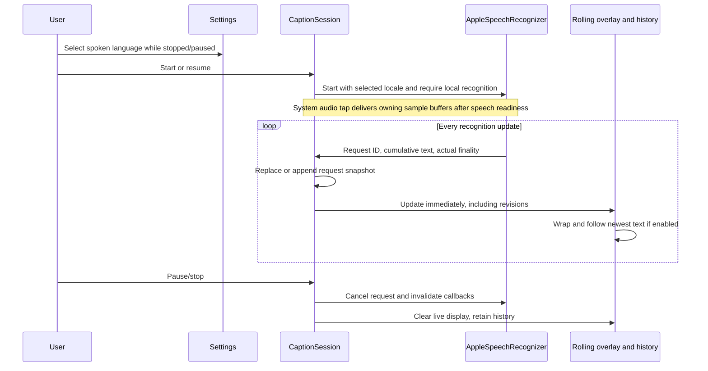
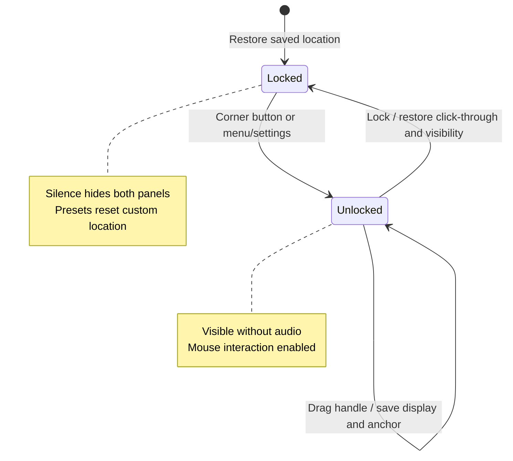

# Architecture

ImmersionCaption 0.7.1 uses native presentation, a MainActor caption coordinator, a domain package using Foundation and native geometry values, and replaceable system-audio/speech adapters. Runtime minimum: macOS 14.2. Translation and external inference services are absent.

[SVG](docs/diagrams/architecture.svg) · [PNG](docs/diagrams/architecture.png) · [Editable Mermaid](docs/diagrams/architecture.mmd)

## Responsibilities

- **CaptionCore:** Caption identifies one request snapshot with text, language, actual finality, and first-seen time. LiveTranscript replaces partials in place, preserves final entries, retracts empty revisions, and bounds history. SessionState defines lifecycle policy. SavedOverlayPosition and OverlayGeometry validate, normalize, restore, and constrain window locations without AppKit. No Speech/Core Audio/UI/network dependency.
- **Application/Ports.swift:** SystemAudioCapturing delivers owning CMSampleBuffer values. SpeechRecognizing starts with an explicit language identifier and emits cumulative text, request ID, and actual finality. No timing ranges or punctuation segmenter are needed for display.
- **RecognitionLanguage:** Provider-neutral locale ID/name/on-device capability, plus saved-identifier normalization. The Apple adapter supplies catalog values.
- **CaptionSession:** Snapshots the selected language at start; coordinates permissions, capture, and recognition. Each changed event updates 300-block history and an independent three-block display. Generations reject stale callbacks and visibility polling. There is no punctuation, stability, or finality display gate.
- **Infrastructure/Speech:** AppleSpeechRecognizer discovers supported locales and capability hints. At start it constructs the selected recognizer, checks availability/on-device support, and requires on-device recognition. Actual final results and the legacy maintenance timer start new requests. Callback values cross to MainActor; obsolete request IDs are rejected.
- **Infrastructure/Audio:** CoreAudioTapCapture owns the private global process tap and tap-only aggregate. Dedicated control/sample queues manage HAL resources and owning PCM copies. Stop suppresses queued delivery/errors and cleans up partial startup.
- **Persistence:** AppSettings filters the catalog to on-device languages, resolves saved selection within that list, and stores appearance, chosen language, click-through, a maximum caption-line preference (1/2/3, default 3), and a single preset/custom placement value. Legacy position presets migrate automatically. Preview and unlock state are transient; every launch starts locked. Retired backend keys are removed. History is not automatically persisted.
- **Presentation:** Shared native language menus disable changes while running/transitioning. SubtitleView retains the header/Follow live controls and hosts CaptionTextView. Its native CaptionScrollView uses TextKit for wrapping, scrolling to newest text when following, and manual review when following is off. CaptionTextMetrics supplies a uniform line height shared by the renderer and panel: the viewport is exactly one, two, or three lines tall. Three request snapshots remain in the document; the line preference never cuts recognition text or history. SubtitleOverlayController owns a nonactivating caption panel plus a small child panel for the lock button. The caption panel ignores mouse events only when locked with click-through enabled; the child remains interactive. Click-through hides the header/Follow live control and scrollbars and forces automatic following. History rows are revised in place and exported explicitly.
- **AppContainer:** Discovers the language catalog, injects a selected-language closure, selects adapters, and defers overlay hosting-view creation until view startup.

## Data flow

## Ownership and lifecycle

Session/settings/presentation are MainActor isolated. Audio control and callbacks have separate serial queues. HAL memory is copied before callback return. AudioTapOutput synchronizes delivery with disable; SpeechAudioSink serializes append with endAudio/replacement. No audio is stored on disk.

Session and request UUIDs reject obsolete speech callbacks. Coordinator generations invalidate callbacks and visibility monitoring during pause/stop/failure/restart. Transition counters prevent overlapping starts while authorization or teardown is pending. A late permission response cannot revive a stopped session. Capture uses its own generation and partial-setup cleanup.

History retains up to 300 request blocks, including their current provisional text. Updates preserve entry identity/time. Display retains three recent blocks from the current run and is cleared at pause/stop, so resuming in another language does not mix prior-run text into the window. Clear History does not hide the live display; later updates may add the active block again. The latest snapshots remain available for export without saving every revision.

AppContainer injects a factory for the AudioActivityMonitoring port. Every capture run receives a fresh PCMActivityMonitor; the capture receiver passively inspects its owning sample before delivering the same sample to recognition. Only a lock-protected monotonic last-audible timestamp is shared with MainActor. No per-buffer tasks, retained audio, or speech endpoint events are introduced.

When positioning is locked, one cancellable 100 ms task hides the entire panel once audio has remained below the -80 dBFS peak floor for one second, including when capture callbacks stop. It only publishes a visibility change when needed. Changed recognition results update snapshots/history regardless of silence, but reveal the panel only with recent audio. Audio resuming alone does not expose old captions. The Keep Onscreen setting and saved override are removed; preview is available only outside running/starting states. Unlocked positioning intentionally keeps the overlay visible and interactive until relocked, without changing recognition or the saved click-through preference. Stop clears display and monitor ownership.

The meter supports common float/integer PCM, planar/interleaved layouts, and endian handling. Unfamiliar formats conservatively count as activity to avoid suppressing valid speech. Its silence threshold/grace is our display heuristic, not VAD or Apple's private behavior. It never finalizes, cancels, or restarts speech recognition. Follow live remains reviewable in interactive mode and is automatic in click-through mode.

## Visible caption lines

AppSettings.maximumCaptionLines is a persisted CaptionLineLimit enum with One, Two, and Three choices. Missing/invalid saved values use Three. Settings changes apply immediately without restarting recognition. The presentation controller consumes the published choice directly and resizes the panel through the existing placement rules; custom top-left anchors remain stable unless screen clamping is required.

CaptionTextView bridges a read-only NSTextView inside NSScrollView. CaptionTextMetrics uses the selected font with extra room for CJK/emoji fallback glyphs. The renderer sets equal [minimum](https://developer.apple.com/documentation/appkit/nsmutableparagraphstyle/minimumlineheight) and [maximum](https://developer.apple.com/documentation/appkit/nsmutableparagraphstyle/maximumlineheight) paragraph line heights, zero container insets, and no inter-block spacing. The viewport height is that shared line height multiplied by the selected count. This avoids approximate font-size-based viewport heights and partial adjacent rows when following.

Request snapshots are joined with a paragraph break for display only. TextKit wraps the full text; no characters are removed, shortened, or replaced with ellipses. Following scrolls to the bottom after text/layout changes; turning Follow live off preserves the review offset. Locked click-through still hides the scrollbar and forces following. History keeps its original request snapshots and capacity. Header, lock button, and padding sit outside the caption-line budget.

## Overlay positioning

The corner lock control and menu/settings command share AppSettings.isOverlayLocked. Locked mode keeps normal caption visibility and click-through. Unlocked mode exposes a dedicated NSView drag handle and keeps the panel visible for positioning even with no audio. The handle calls native [NSWindow.performDrag(with:)](https://developer.apple.com/documentation/appkit/nswindow/performdrag(with:)); text scrolling and Follow live remain separate controls. No Accessibility permission or global event monitor is added.

The lock button uses a separate 28-point child panel because ignoresMouseEvents applies to the caption window. AppKit [detaches child windows on orderOut](https://developer.apple.com/documentation/appkit/nswindow/orderout(_:)), so the controller reattaches the control on every reveal. Native parent movement then carries the control with it. Both panels hide together when locked and silent.

On movement, the controller chooses the display containing the header (or the greatest overlap), then saves its stable display UUID and a normalized top-left anchor in UserDefaults. Pure OverlayGeometry functions constrain the whole frame to the visible screen area with a small margin. Normalized coordinates accommodate resolution changes; the top edge remains stable when the header or font changes unless clamping is necessary. A missing display falls back to the primary screen while preserving the original preference for reconnection. Screen-configuration notifications reapply safe geometry.

Native movement saves without immediately reapplying the frame, avoiding recursive snapping. Coalesced movement notifications constrain an offscreen location after movement settles. Recognition/visibility updates leave an already-visible frame alone. Settings changes and a hidden-to-visible transition restore the saved placement; choosing a preset clears the custom anchor. Published values are consumed directly to avoid Combine's willSet timing, and an explicit applying-frame guard excludes programmatic positioning from user-move persistence.

## Engine replacement and limitations

Implement SpeechRecognizing with local-only audio conversion/inference and cumulative request snapshots. Select the adapter in AppContainer. A delta/range-based engine needs an adapter or an explicit event-contract change. The current public SFSpeechRecognizer is not claimed to be the built-in Live Captions engine.

Initial OS language assets may require downloading outside the app. No direct model manager or cloud fallback exists. The legacy 45-second request rotation has no overlapping audio buffer and can lose audio. Cross-request text overlap is not deduplicated; legitimate repeated speech must be retained. Unsupported local languages fail explicitly before capture starts.

See [research](docs/LIVE_CAPTIONS_RESEARCH.md), [exact policy](docs/CAPTION_POLICY.md), and [verification](docs/VALIDATION.md). Permissions, sustained multilingual audio, overlay scrolling/Spaces, and recognition quality still require interactive acceptance beyond synthetic tests.
