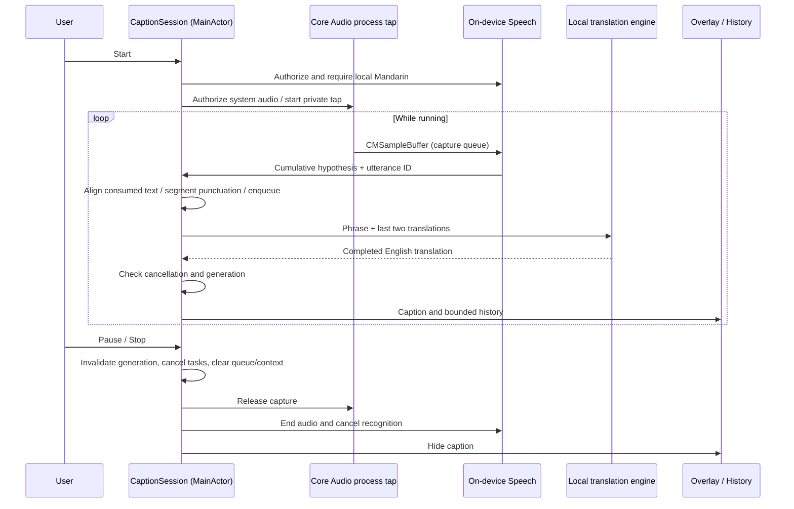

# Architecture

ImmersionCaption uses a small MVVM-style presentation layer with a dedicated application coordinator and replaceable infrastructure adapters. The minimum runtime is macOS 14.2, which provides Core Audio process taps and system-audio-only authorization. Swift 5.9 is the minimum app compiler; the Foundation-only domain package also supports the initially installed Swift 5.3 tools.

## Responsibilities and dependencies

[Open the full-size SVG](docs/diagrams/architecture.svg) · [PNG](docs/diagrams/architecture.png) · [Editable Mermaid source](docs/diagrams/architecture.mmd)

This is a component map, not a runtime sequence. Solid arrows show existing calls, observations, or policy dependencies. Each provider box pairs an application protocol with its current infrastructure adapter. The dashed arrow and gray section show the planned embedded replacement; they are not implemented. AppContainer assembles the current providers and settings and defers overlay creation until view startup. The sequence diagram below shows the actual audio-to-caption flow.

- **CaptionCore** has no UI, HTTP, Speech, Core Audio, Combine, or dependency on Ollama's transport. Its `TranslationPrompt` is a named TranslateGemma policy helper; other translation models can ignore it. Values and bounded queues remain provider-neutral.
- **Application/Ports.swift** defines `SystemAudioCapturing`, `SpeechRecognizing`, and `TranslationEngine`. Capture and speech exchange native `CMSampleBuffer` audio; the capture adapter copies HAL buffers into owning sample buffers without resampling. That boundary is intentionally macOS-specific; replaceable speech adapters must accept or convert these buffers. Transcript events carry provider-neutral `SpeechSegment` values (UTF-16 range, start time, duration) for revision alignment; timings do not choose source boundaries. Providers may omit timings, using the text-only fallback. Translation values remain backend-independent.
- **CaptionSession** is the use-case coordinator and observable view model. It owns lifecycle, punctuation segmentation, request-to-request text continuation, translation ordering, history, context, overload reporting, caption expiry, and cancellation.
- **Infrastructure/Audio** owns `CoreAudioTapCapture`: a private, unmuted global stereo process tap and a private aggregate containing only that tap. `NSAudioCaptureUsageDescription` requests system audio access. There is no display enumeration, ScreenCaptureKit dependency/fallback, physical input device, or microphone input. The existing HAL process object is excluded when available; this app produces no playback. The adapter reads the tap’s native PCM format and copies callback memory with `PCMBufferConverter`. A format-change listener stops the session if the format changes; unchanged notifications are ignored.
- **Infrastructure/Speech** manages local Mandarin recognition, synchronized audio append/request replacement, and periodic recognition request rotation. Runtime capability is checked before recognition; `requiresOnDeviceRecognition` is always true.
- **Infrastructure/Translation** owns Ollama JSON, HTTP timeouts, loopback restriction, redirect rejection, completion validation, and error mapping. It does not choose UI state or store history.
- **Infrastructure/Persistence** stores appearance and backend preferences in UserDefaults. History and audio are not automatically persisted.
- **Presentation** observes session/settings. Its click-through panel handles Spaces/fullscreen positioning separately from the content views. Views invoke coordinator methods and do not construct inference adapters.
- **AppContainer** assembles concrete dependencies once. A view task creates the overlay after dependency resolution has finished, avoiding nested hosting-graph creation during SwiftUI StateObject initialization. It retains that overlay even when the main window is closed. The menu bar remains usable.

There is one source-level app module and one local domain package. More packages, repositories, generic pipeline frameworks, or an unused model-manager abstraction would add little value at this stage.

## Data flow

## Concurrency and ownership

Presentation, settings, coordinator, and capture entry points are MainActor-isolated. Each `AudioTapRun` confines native setup/teardown and resource IDs to a serial control queue, keeping permission/device calls off MainActor. Core Audio invokes a separate serial sample queue synchronously. `PCMBufferConverter` copies HAL-owned interleaved or planar PCM into owning `CMSampleBuffer` data before the callback returns, retaining the native sample rate/channel format and advancing frame-based timestamps. A lock-protected `AudioTapOutput` serializes delivery with disable; the existing `SpeechAudioSink` serializes append with request replacement/endAudio. There is no unbounded task stream or disk audio storage. Conversion and format errors hop to MainActor once; stop suppresses queued failure delivery.

Apple recognition callbacks snapshot text/finality and dispatch onto MainActor. Session and request UUIDs reject callbacks after stop or request rotation. Session generation UUIDs reject translation results after pause, stop, failure, or restart, including providers that ignore cancellation. Transition counters prevent new starts during pending startup/teardown. The capture adapter has its own generation to handle cancellation during asynchronous setup/teardown. Stop disables delivery immediately, then stops/destroys the IOProc, removes the format listener, destroys the aggregate, and destroys the tap on the control queue. Partial startup failures follow the same cleanup path. Run resources are never reused by a later session.

One worker Task translates sequentially so context is ordered. At most three additional phrases wait; dropping the oldest pending phrase preserves newer dialogue at the expense of completeness. The caption-expiry Task is replaced/cancelled as appropriate; there is no stable-draft translation timer. A failed backend visibly stops the pipeline; there is no retry storm or cloud fallback.

## Segmentation and latency tradeoffs

The [current caption policy diagram and code walkthrough](docs/CAPTION_POLICY.md) documents exact decision priority, revision alignment, request transitions, and examples. **There is no stable-prefix confirmation gate:** a punctuated partial can be committed on its first appearance. Consumed-position alignment does not establish recognition stability or retroactively correct translations.

The legacy recognizer emits cumulative hypotheses and speech-unit timestamps; one unit can contain several words. `AppleSpeechRecognizer` requests automatic punctuation and copies units into `SpeechSegment` values before crossing to MainActor. Ranges reference the original formatted text in UTF-16; the domain validates them before converting to Swift string indices.

`TranscriptSegmenter` searches the entire pending text for the first complete sentence (`。！？!?`, newline, or an eligible ASCII full stop), keeping adjacent closing quotes with it. That sentence takes priority over earlier commas, regardless of character count. If no sentence end is available and the result is partial, the first comma/colon/semicolon after at least ten characters can commit a punctuation-delimited clause. Numeric commas/time colons, decimal points, and common English abbreviations are protected. An actual final result commits the remaining utterance intact when there is no sentence ending.

There are no character, word-gap, duration, tokenization, or stable-text splitting triggers. The Short/Balanced preference and `CaptionLength` type were removed. Timings only help align revisions, so a pause does not become a linguistic boundary. Punctuation is still heuristic: an ASR comma can be premature and a clause can be semantically incomplete. The policy prefers sentence integrity but does not run a semantic endpoint model.

Once committed, text is not retracted. Consumed word timestamps realign earlier text revisions; missing/all-zero timings use `TranscriptCursor` to follow the consumed boundary through a text diff. All-zero timestamps cannot establish an audio watermark. Text anchors exclude ambiguous shared punctuation; a fully rewritten transcript without anchors uses a conservative positional fallback. Revised/merged word boundaries remain an edge case.

The Apple adapter rotates requests every 45 seconds without synthesizing a final result. When the request ID changes, `TranscriptSegmenter.beginUtterance()` carries only the uncommitted tail and resets timing/revision anchors. The next cumulative hypothesis is prefixed with that tail; current request UTF-16 ranges are offset into the combined text. A real final result can flush an unpunctuated utterance, and pause/stop clears the carry. There is no overlapping audio buffer, so text continuity does not eliminate possible audio loss during rotation. Tests cover no forced cuts, full-sentence priority, permissible comma clauses, real finals, multiple rotations, timing resets, emoji offsets, earlier revisions, and replay prevention.

Text may wait longer when the recognizer provides neither punctuation nor a real final result. Long complete sentences are passed to translation intact; visual wrapping/scaling is separate. The bounded overlay can still truncate very long translations, and the local model has context/output limits. Pagination and semantic completeness scoring are not implemented.

Non-streamed completed translations avoid displaying unfinished model output and simplify the initial adapter. Warm fixture translation was subsecond locally; actual end-to-end latency remains unmeasured. Recognized punctuation, model load time, speech rate, and recognition availability dominate the user experience. Larger models may improve fluency while increasing memory/latency; changing models must be evaluated with real listening sessions.

## Translation policy

The current adapter uses TranslateGemma's documented single user message, Chinese `zh-Hans` → English `en`, and its source separator. Guidance prioritizes natural conversational English, idiom meaning, tone, fidelity, and no added facts. Two previously translated pairs provide limited context, explicitly separated from the current source. The prompt requests one translation of the current fragment, no alternatives or repetition of context, no invented continuation, and preservation of narrative subjects. Temperature is 0 to reduce sampling variation; context changes and backend differences can still change wording. Output is accepted only after a complete nonempty response; token-limit truncation is an error. One response can legitimately contain multiple English sentences; it always creates just one caption entry.

Context can help ambiguous words but also propagate earlier mistakes. It is cleared on lifecycle transitions and when history is cleared. There is no claim that prompting guarantees semantic fidelity or native fluency. Human-reviewed regression fixtures record real weaknesses.

## Privacy boundary

The app does not configure a microphone and registers no microphone stream output. It never opens a screen-capture stream, stores no raw audio, and retains at most 300 captions in memory. History export is user initiated. Logs describe lifecycle/failure categories only, not recognized or translated content.

The Ollama adapter accepts explicit HTTP loopback URLs, disables proxy configuration, and rejects redirects. This confines the application's HTTP transport; a locally configured server could itself forward data. Users must run trusted Ollama with a genuinely local model. Initial setup/model downloads can require internet. Offline operation requires both Apple's language assets and the translation weights/runtime to be available beforehand.

## Replacing AI engines and becoming standalone

1. Implement `TranslationEngine.translate(_:)` using a compatible embedded runtime. It receives a provider-neutral source/context value and returns English, honoring cancellation. Put model-specific prompts/tokenization inside that adapter.
2. In AppContainer, replace OllamaTranslationEngine with the embedded adapter. CaptionSession, history, overlay, and tests remain unchanged.
3. If replacing Apple Speech with Whisper or another local recognizer, implement SpeechRecognizing. Convert input CMSampleBuffer format internally, perform inference off-main, return cumulative hypotheses with stable utterance IDs, include UTF-16 word ranges/timings where available, and enforce local-only behavior.
4. Add direct model management when an embedded backend is selected: manifests, source/license notices, storage location, size/free-space checks, integrity verification, interrupted-download handling, supported hardware/quantization, removal, and first-run readiness. None of these are implemented yet.
5. Package the runtime, permitted model assets or installer, entitlements, signing, and notarization into a distributable app. Validate with Ollama absent, network disabled, and a clean macOS account.

Standalone deployment is an architectural path, not a completed feature. The current app still requires Ollama and OS-managed speech assets.

## Verification boundaries

Domain XCTest sources and a compatibility runner exercise actual production rules, including punctuation segmentation, timing-based revision alignment, and continuation across request rotations. App XCTest sources cover suppression of timer-driven cuts, request continuity, lifecycle cancellation/generation races, overload/context ordering, recognition failure teardown, the HTTP request schema, invalid responses, endpoint validation, and deferred native-window creation. An opt-in integration test runs the real Swift Ollama adapter against installed TranslateGemma. Interactive permissions, overlay behavior, sustained speech, and end-to-end audio tests remain outstanding. See docs/VALIDATION.md for current test/build/launch evidence and the acceptance checklist.
