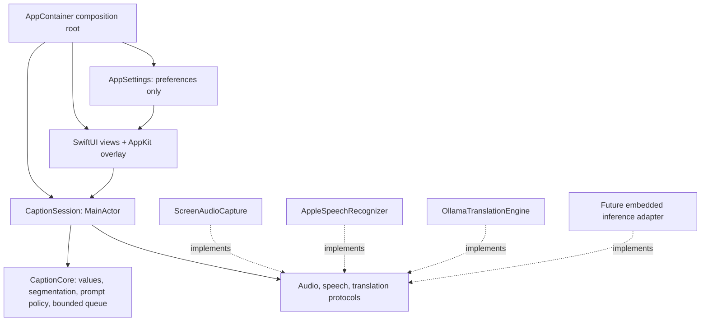
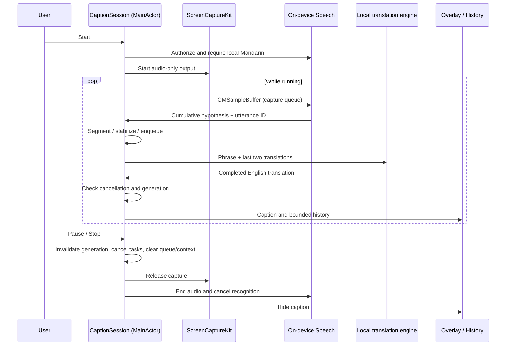

# Architecture

ImmersionCaption uses a small MVVM-style presentation layer with a dedicated application coordinator and replaceable infrastructure adapters. The minimum runtime is macOS 13, which provides ScreenCaptureKit application-audio capture. Swift 5.9 is the minimum app compiler; the Foundation-only domain package also supports the initially installed Swift 5.3 tools.

## Responsibilities and dependencies

- **CaptionCore** has no UI, HTTP, Speech, ScreenCaptureKit, Combine, or dependency on Ollama's transport. Its `TranslationPrompt` is a named TranslateGemma policy helper; other translation models can ignore it. Values and bounded queues remain provider-neutral.
- **Application/Ports.swift** defines `SystemAudioCapturing`, `SpeechRecognizing`, and `TranslationEngine`. Capture and speech exchange native `CMSampleBuffer` audio to avoid unnecessary conversion. That boundary is intentionally macOS-specific; replaceable speech adapters must accept or convert these buffers. Transcript and translation values are backend-independent.
- **CaptionSession** is the use-case coordinator and observable view model. It owns lifecycle, segmentation, draft stabilization, translation ordering, history, context, overload reporting, caption expiry, and cancellation.
- **Infrastructure/Audio** manages ScreenCaptureKit and its permission-triggering content enumeration. It registers only audio output, excludes this process, minimizes unused video configuration, and never creates a microphone input.
- **Infrastructure/Speech** manages local Mandarin recognition, synchronized audio append/request replacement, and periodic recognition request rotation. Runtime capability is checked before recognition; `requiresOnDeviceRecognition` is always true.
- **Infrastructure/Translation** owns Ollama JSON, HTTP timeouts, loopback restriction, redirect rejection, completion validation, and error mapping. It does not choose UI state or store history.
- **Infrastructure/Persistence** stores appearance and backend preferences in UserDefaults. History and audio are not automatically persisted.
- **Presentation** observes session/settings. Its click-through panel handles Spaces/fullscreen positioning separately from the content views. Views invoke coordinator methods and do not construct inference adapters.
- **AppContainer** assembles concrete dependencies once. A view task creates the overlay after dependency resolution has finished, avoiding nested hosting-graph creation during SwiftUI StateObject initialization. It retains that overlay even when the main window is closed. The menu bar remains usable.

There is one source-level app module and one local domain package. More packages, repositories, generic pipeline frameworks, or an unused model-manager abstraction would add little value at this stage.

## Data flow

## Concurrency and ownership

Presentation, settings, coordinator, and adapter control methods are MainActor-isolated. ScreenCaptureKit invokes a dedicated serial audio queue. A lock-protected `AudioOutput` snapshots its receiver before forwarding samples directly to a lock-protected `SpeechAudioSink`. The sink serializes `appendAudioSampleBuffer` with `endAudio`/request replacement. Audio buffers are not placed in an unbounded task stream or written to disk.

Apple recognition callbacks snapshot text/finality and dispatch onto MainActor. Session and request UUIDs reject callbacks after stop or request rotation. Session generation UUIDs reject translation results after pause, stop, failure, or restart, including providers that ignore cancellation. Transition counters prevent new starts during pending startup/teardown. The capture adapter has its own generation to handle cancellation while content enumeration or capture startup is suspended.

One worker Task translates sequentially so context is ordered. At most three additional phrases wait; dropping the oldest pending phrase preserves newer dialogue at the expense of completeness. Stable-draft and caption-expiry Tasks are replaced/cancelled as appropriate. A failed backend visibly stops the pipeline; there is no retry storm or cloud fallback.

## Segmentation and latency tradeoffs

The legacy recognizer emits cumulative hypotheses. `TranscriptSegmenter` commits punctuation-delimited phrases, final tails, or chunks up to 80 grapheme clusters. A one-second unchanged draft also commits. Once committed, text is not retracted. If an earlier hypothesis is edited, positional prefix alignment avoids replaying everything but can split or omit newly revised content. Tests cover pre-commit edits, stable flushes, duplicate partials, boundaries, resets, and overload policy.

Requests rotate after 45 seconds, flushing the most recent hypothesis and starting a new request. There is no overlap buffer, so transition audio loss remains possible. A future timestamp-aware segmentation/VAD pipeline can improve this without changing translation/UI contracts.

Non-streamed short translations avoid displaying incomplete English sentences and simplify the initial adapter. Warm fixture translation was subsecond locally; actual end-to-end latency remains unmeasured. Stable segmentation, model load time, speech rate, and recognition availability dominate the user experience. Larger models may improve fluency while increasing memory/latency; changing models must be evaluated with real listening sessions.

## Translation policy

The current adapter uses TranslateGemma's documented single user message, Chinese `zh-Hans` → English `en`, and its source separator. Guidance prioritizes natural conversational English, idiom meaning, tone, fidelity, and no added facts. Two previously translated pairs provide limited context, explicitly separated from the current source. Output is accepted only after a complete nonempty response; token-limit truncation is an error.

Context can help ambiguous words but also propagate earlier mistakes. It is cleared on lifecycle transitions and when history is cleared. There is no claim that prompting guarantees semantic fidelity or native fluency. Human-reviewed regression fixtures record real weaknesses.

## Privacy boundary

The app does not configure a microphone and registers no microphone stream output. It discards screen video, stores no raw audio, and retains at most 300 captions in memory. History export is user initiated. Logs describe lifecycle/failure categories only, not recognized or translated content.

The Ollama adapter accepts explicit HTTP loopback URLs, disables proxy configuration, and rejects redirects. This confines the application's HTTP transport; a locally configured server could itself forward data. Users must run trusted Ollama with a genuinely local model. Initial setup/model downloads can require internet. Offline operation requires both Apple's language assets and the translation weights/runtime to be available beforehand.

## Replacing AI engines and becoming standalone

1. Implement `TranslationEngine.translate(_:)` using a compatible embedded runtime. It receives a provider-neutral source/context value and returns English, honoring cancellation. Put model-specific prompts/tokenization inside that adapter.
2. In AppContainer, replace OllamaTranslationEngine with the embedded adapter. CaptionSession, history, overlay, and tests remain unchanged.
3. If replacing Apple Speech with Whisper or another local recognizer, implement SpeechRecognizing. Convert input CMSampleBuffer format internally, perform inference off-main, return cumulative hypotheses with stable utterance IDs, and enforce local-only behavior.
4. Add direct model management when an embedded backend is selected: manifests, source/license notices, storage location, size/free-space checks, integrity verification, interrupted-download handling, supported hardware/quantization, removal, and first-run readiness. None of these are implemented yet.
5. Package the runtime, permitted model assets or installer, entitlements, signing, and notarization into a distributable app. Validate with Ollama absent, network disabled, and a clean macOS account.

Standalone deployment is an architectural path, not a completed feature. The current app still requires Ollama and OS-managed speech assets.

## Verification boundaries

Domain XCTest sources and a compatibility runner exercise actual production rules. App XCTest sources cover lifecycle cancellation/generation races, overload/context ordering, recognition failure teardown, the HTTP request schema, invalid responses, endpoint validation, and deferred native-window creation. An opt-in integration test runs the real Swift Ollama adapter against installed TranslateGemma. All 24 tests passed with Xcode 27 / Swift 6.4 and live inference enabled. The release bundle passed signature verification and a process/window launch check. Interactive permissions, overlay behavior, sustained speech, and end-to-end audio tests remain outstanding. See docs/VALIDATION.md for measured evidence and the acceptance checklist.
