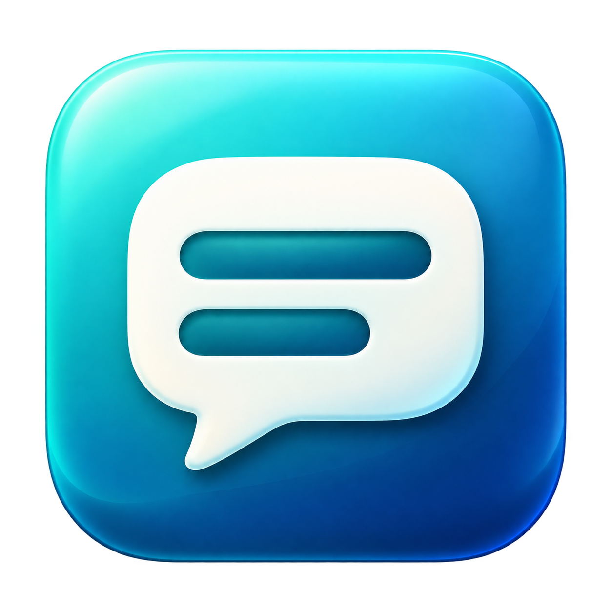

# ImmersionCaption



A native macOS app displaying live captions for application audio in a user-selected spoken language. Capture and recognition run locally. No microphone, translation service, or Ollama installation is required.

**Version 0.6.2: selectable languages and rolling live text.** Partial results appear immediately and corrections replace the current text in place. Punctuation and final results no longer gate display. The [research note](docs/LIVE_CAPTIONS_RESEARCH.md) explains the macOS Live Captions reference and the limits of that comparison.

## Features

- Core Audio process-tap capture of system/application output; no screen or microphone recording.
- Spoken-language menu in the main window, settings, and menu bar. Options come from Apple Speech; on-device capability varies by language and Mac.
- On-device recognition without cloud fallback. Language selection is explicit, not automatic detection.
- Rolling, naturally wrapped text that supports revisions, scrolling, Follow live, and optional click-through.
- Font size, background opacity, position presets, preview, and automatic hiding during silence.
- Start/pause/resume/stop, menu controls, visible errors, and latest-300-block memory-only history with text export.

## Requirements

- macOS 14.2+ and on-device speech assets for the selected language; Apple Silicon recommended.
- Xcode 15.2+ with Swift 5.9+ for building. CaptionCore also supports the original Swift 5.3 compatibility checks.
- No third-party source-package dependencies or external inference services.

Language options are discovered at startup. Only options advertising on-device support are shown. A saved unavailable language falls back to a visible option; if none qualify, the menu shows an empty-state message. Install missing language data in macOS Keyboard → Dictation settings and reopen the app. Start rechecks recognition availability; the app fails explicitly instead of using a network recognizer.

## Build and install

Complete Xcode setup and select its command-line tools. From the repository root:

```sh
swift test --package-path Packages/CaptionCore
swift test
scripts/build-app.sh
open build/ImmersionCaption.app
```

The build generates the icon and an ad-hoc signed development bundle at build/ImmersionCaption.app. Copy it into Applications to install locally. Quit older copies and use one bundle for permissions. Launch the packaged app for permission testing rather than swift run.

## Usage

1. Choose **Spoken language**, matching the audio you intend to play, then **Start captions**.
2. Allow Speech Recognition and System Audio Recording. The audio-only permission may appear under Privacy & Security → Screen & System Audio Recording → System Audio Recording Only. Screen and microphone permissions are not needed.
3. Play audio in another application. Text appears as recognized, including unfinished speech; earlier words may change.
4. To change language, pause or stop, choose another language, then resume/start. The live window starts fresh; existing history keeps its language labels.
5. In interactive mode, leave **Follow live** on to track new text, or turn it off to scroll back. With **Click-through overlay** enabled, the header/toggle and scrollbars are hidden and following is automatic.
6. Adjust font, opacity, and position in Settings. Preview shows the overlay while stopped/paused without recording; it does not override automatic hiding during a running session.

Closing the main window leaves menu controls available; Quit ImmersionCaption exits. The entire caption window, including its background, hides after about one second without audible system output. Recognition continues. The window reappears when a changed recognition result arrives with recent audio; sound alone and late results in silence do not reveal old text. The former Keep Onscreen override is removed. Pause/stop clears the live display but retains history. Clear affects history, and subsequent updates can add the active block again. Export writes the current text snapshots to a chosen location.

## Display policy and limits

See the [policy diagram](docs/CAPTION_POLICY.md) and [architecture](ARCHITECTURE.md). Each recognition request owns a revisable block. Partials replace its text instead of appending duplicate sentences. A real final marks the same entry final. The window retains three recent blocks and scrolls at the chosen font size, without arbitrary source cuts or font shrinking. History retains the latest 300 blocks.

The 45-second legacy request rotation can create audio gaps; audio overlap buffering is not implemented. Separate requests can repeat overlapping speech because no cross-request text deduplication is imposed. The public recognizer's latency/quality and supported locales can differ from built-in Live Captions. Sentence-level history, automatic language detection, semantic endpointing, translation, and direct asset downloading are not implemented.

Capture uses a private global stereo mix without changing default devices. Protected audio may be unavailable. Device-format changes and speech errors stop processing visibly. Resizing/dragging the overlay is not implemented; use position presets. This is an ad-hoc development build; distribution signing and notarization remain planned.

## Project structure and verification

```text
Packages/CaptionCore/                 caption snapshots, LiveTranscript, lifecycle policy, tests
Sources/ImmersionCaption/
  App/                               composition root and app lifecycle
  Application/                       capture/speech ports, language values, caption session
  Infrastructure/                    Core Audio, selected Apple Speech locale, preferences
  Presentation/                      language menus, controls, settings, history, rolling overlay
Resources/                           icon, privacy descriptions, entitlements
Tests/ImmersionCaptionTests/          revisions, languages, lifecycle, settings, PCM, startup
scripts/                             build, launch, environment, compatibility checks
docs/                                research, policy, architecture diagrams, validation
```

Run scripts/test-core-compat.sh for Foundation-only domain checks. scripts/check-app-launch.sh checks process/window metadata after building and leaves the app open; it does not test live audio. See [validation evidence](docs/VALIDATION.md) and [development rules](AGENTS.md).

A passive PCM monitor uses a conservative -80 dBFS peak floor and a one-second grace to avoid flickering between words. It is an output-activity heuristic rather than voice detection; unusually quiet signals can fall below its floor. Audio and history are not automatically saved. Preferences use UserDefaults; export is explicit. Logs contain lifecycle/error categories rather than audio/transcripts. Initial OS asset downloads may need internet; installed local assets are required for offline recognition. Removing the old translation integration does not uninstall external apps or their models.
