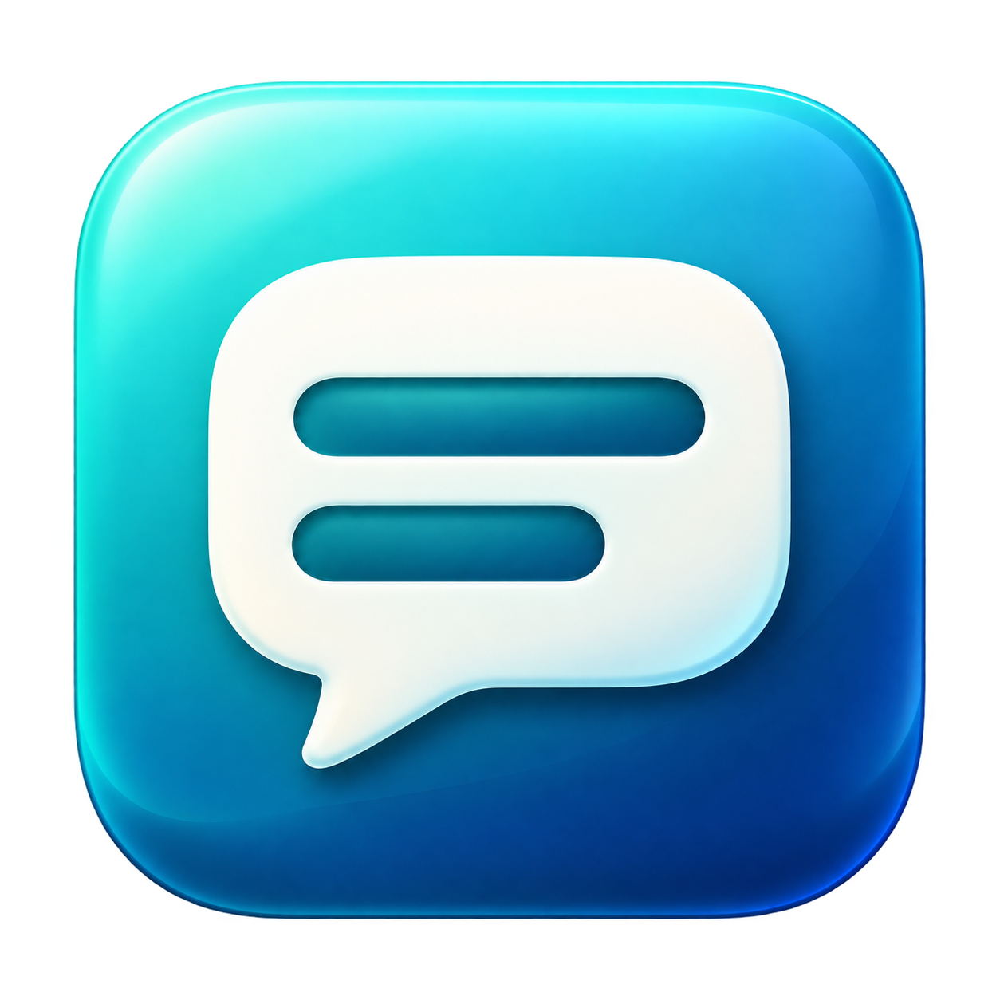

# ImmersionCaption

[English](README.md) | **简体中文**



ImmersionCaption 是一款原生 macOS 实时字幕应用，可识别其他应用播放的语音，并以用户选择的口语语言显示字幕。音频采集和语音识别均在本机完成，无需麦克风、翻译服务或 Ollama。

**0.7.1：支持设置字幕最大行数。** 在设置中选择显示一行、两行或三行自动换行后的字幕，默认三行。解锁字幕窗口后，可通过拖动手柄调整位置，再锁定并保存。识别中的文字会立即显示，后续修正直接替换原文，无需等待标点或最终识别结果。[研究记录](docs/LIVE_CAPTIONS_RESEARCH.md)说明了 macOS 实时字幕的参考依据及两者的差异。

## 功能

- 通过 Core Audio 进程音频分流采集系统或应用输出，不录制屏幕，也不使用麦克风。
- 主窗口、设置和菜单栏均可选择语音语言。选项来自 Apple Speech；本地识别能力因语言和 Mac 而异。
- 强制使用设备端语音识别，不会自动回退到云端。需要手动选择输入语言，目前不支持自动检测语言。
- 字幕自然换行、滚动显示，支持识别修正、跟随最新内容和可选的鼠标穿透。
- 可调整字号、最大可见行数（一行／两行／三行）、背景不透明度及位置；支持锁定／解锁、拖动并保存自定义位置、位置预设、预览，以及静音时自动隐藏。
- 支持开始、暂停、继续和停止，提供菜单栏控制及错误提示。历史记录保留最近 300 个识别请求的文本快照，仅存于内存，支持手动导出。

## 环境要求

- macOS 14.2 或更高版本，并已具备所选语言的设备端语音识别资源；推荐使用 Apple 芯片 Mac。
- 构建需要 Xcode 15.2 或更高版本及 Swift 5.9 或更高版本。CaptionCore 也保留了原有的 Swift 5.3 兼容检查支持。
- 不依赖第三方源码包，也不需要外部推理服务。

应用在启动时获取语言列表，只显示声明支持设备端识别的选项。若之前保存的语言已不可用，会选择列表中的可用语言；若没有符合条件的语言，则显示空状态提示。可在 macOS「键盘 → 听写」设置中安装缺少的语言数据，然后重新打开应用。开始识别时会再次检查可用性；若检查失败，应用会明确报错，而不会使用网络识别。

## 构建与安装

可直接从 [GitHub Releases](https://github.com/mattt-s/ImmersionCaption/releases/tag/v0.7.1) 下载适用于 **Apple 芯片 Mac / macOS 14.2+** 的安装包，无需自行编译。DMG 支持拖入「应用程序」安装，PKG 使用 macOS 安装器；两者均为未完成 Developer ID 签名及公证的开发版。以下为源码构建步骤。

完成 Xcode 的首次启动配置，并选择其命令行工具。在项目根目录执行：

```sh
swift test --package-path Packages/CaptionCore
swift test
scripts/build-app.sh
open build/ImmersionCaption.app
```

构建脚本会生成图标，并在 build/ImmersionCaption.app 创建使用临时签名（ad-hoc）的开发版应用。将其复制到「应用程序」即可在本机安装。请退出旧版本，使用同一份应用处理权限授权。测试权限时应启动打包后的应用，而不是使用 swift run。

## 安装包

运行 `scripts/package-app.sh`，脚本会重新构建应用，并在 build/ 中生成原生安装包：

- **[ImmersionCaption-0.7.1-arm64.pkg](https://github.com/mattt-s/ImmersionCaption/releases/download/v0.7.1/ImmersionCaption-0.7.1-arm64.pkg)**：双击后通过 macOS 安装器安装到 /Applications/ImmersionCaption.app，可能需要管理员授权。安装前请退出旧版本。安装目标固定，不会搜索并替换其他目录中的开发副本。
- **[ImmersionCaption-0.7.1-arm64.dmg](https://github.com/mattt-s/ImmersionCaption/releases/download/v0.7.1/ImmersionCaption-0.7.1-arm64.dmg)**：打开磁盘映像，将应用拖入 Applications，再启动安装后的副本。映像内附中英文安装说明。
- **[ImmersionCaption-0.7.1-arm64.sha256](https://github.com/mattt-s/ImmersionCaption/releases/download/v0.7.1/ImmersionCaption-0.7.1-arm64.sha256)**：两个安装包的 SHA-256 校验值。在项目根目录运行 `(cd build && shasum -a 256 -c ImmersionCaption-0.7.1-arm64.sha256)` 可进行校验；若已进入 build/，执行 `shasum -a 256 -c ImmersionCaption-0.7.1-arm64.sha256`。

文件名会随应用版本及实际二进制架构变化。当前 arm64 安装包需要 Apple 芯片 Mac 和 macOS 14.2 或更高版本。安装器会检查应用的系统及架构要求，只安装应用本体，不包含安装脚本。偏好、历史及 AI 语言资源不会打入安装包；仍需提前准备由 macOS 管理的本地语言资源。

当前安装包用于开发测试：默认采用 ad-hoc 应用签名，.pkg 未签名，两个安装包均未经公证。面向分发的 Developer ID 签名和公证仍在计划中。若已有证书，可分别通过 CODE_SIGN_IDENTITY 和 INSTALLER_SIGN_IDENTITY 配置应用及安装器签名；公证仍需单独完成。打包脚本不会自动安装或启动应用。

## 发布新版本

维护者和 AI coding agent 请参阅[Release 发布指南](docs/RELEASING.md)，按流程完成 GitHub CLI 授权、打包、草稿上传、校验与下载验证、正式发布和文档更新。[AGENTS.md](AGENTS.md) 同时记录了必须遵守的关键规则。

## 使用方法

应用中的控件名称目前为英文，以下保留原名称并附上中文说明。

1. 在 **Spoken language**（语音语言）中选择与音频一致的语言，然后点击 **Start captions**（开始字幕）。
2. 允许「语音识别」和「系统音频录制」权限。纯音频权限可能位于「隐私与安全性 → 屏幕与系统音频录制 → 仅系统音频录制」。无需屏幕录制或麦克风权限。
3. 在其他应用中播放音频。文字在识别过程中立即显示，包括尚未说完的内容；先前的文字可能被后续结果修正。
4. 切换语言前先暂停或停止，选择新语言后再继续或开始。字幕窗口会重新开始显示，已有历史记录仍保留原语言标签。
5. 在可交互模式下，开启 **Follow live**（跟随实时字幕）可自动滚动至最新内容；关闭后可向上滚动查看。锁定位置且开启 **Click-through overlay**（字幕鼠标穿透）时，会隐藏标题栏、跟随开关及滚动条，并始终跟随最新内容。角落的小锁按钮仍可点击。
6. 点击角落的锁按钮解锁位置，再拖动标题栏中的 **Drag to move**（拖动以移动）手柄。点击解锁图标即可重新锁定。解锁期间，字幕窗口会暂时接收鼠标操作，并在没有声音时保持可见；锁定后恢复已保存的鼠标穿透偏好及正常隐藏行为。
7. 如果字幕已隐藏，可在菜单栏或设置中选择 **Unlock and move captions**（解锁并移动字幕）。自定义位置在字幕更新、隐藏／重新显示及重启应用后保留；每次启动时默认锁定。拖动后，设置中的位置显示为 **Custom**（自定义）。选择 **Top**（顶部）、**Middle**（中部）或 **Bottom**（底部）可清除自定义位置并恢复预设。
8. 在设置中调整字号、**Maximum caption lines**（字幕最大行数，One／Two／Three）和背景不透明度。窗口高度随行数立即变化；开启跟随时显示最新内容，较早文字仍可滚动查看，也会保留在历史记录中。停止或暂停时可预览字幕而不采集音频；预览不会覆盖运行中的静音隐藏规则。解锁定位属于单独的编辑模式。

关闭主窗口后仍可使用菜单栏控制；选择 Quit ImmersionCaption 可退出应用。位置锁定时，系统输出约一秒没有可闻声音后，整个字幕窗口（包括背景和锁按钮）会隐藏，但语音识别继续运行。当最近有声音且收到有变化的识别结果时，窗口才会重新出现；仅恢复声音，或静音期间迟到的识别结果，都不会使旧字幕重新出现。之前的 Keep Onscreen（保持显示）选项已移除。暂停或停止会清空实时显示，但保留历史记录。清空历史记录不会清除实时显示，后续更新仍可能将当前文本重新加入历史。导出会将当前文本快照写入用户选择的位置。

## 显示策略与已知限制

详见[字幕策略及流程图](docs/CAPTION_POLICY.md)和[架构说明](ARCHITECTURE.md)。每个识别请求对应一个可修正的文本块。中间结果替换同一文本块，而不会重复追加句子；真实的最终结果只将该条目标记为最终状态。实时显示缓冲区保留最近三个识别请求的文本块，可见区域则按所选字号最多显示一行、两行或三行自动换行后的文字。行数设置不会强行切断原文，也不会自动缩小字体。历史记录保留最近 300 个文本块。

目前沿用的识别器每 45 秒轮换一次请求，可能产生音频间隙，尚未实现重叠音频缓冲。不同请求的边界语音可能重复，因为应用没有跨请求去重。公开 SFSpeechRecognizer 的延迟、识别质量和语言支持可能与 macOS 内置「实时字幕」不同。目前未实现按句子整理历史、自动语言检测、语义断句、翻译或直接下载模型资源。

音频采集使用私有的全局立体声混音，不会更改默认音频设备。受保护的音频可能无法采集。设备格式变化或语音识别错误会停止处理并显示错误。解锁后可以拖动字幕，但目前不支持手动缩放窗口。自定义位置使用相对于显示器的左上角锚点保存，并限制在屏幕可见区域内。若原显示器未连接，会回退到主显示器；重新连接后可恢复到原显示器。当前为临时签名的开发版，面向分发的代码签名和公证仍在计划中。

## 项目结构与验证

```text
Packages/CaptionCore/                 文本快照、识别／生命周期策略、位置几何计算及测试
Sources/ImmersionCaption/
  App/                               依赖组装与应用生命周期
  Application/                       音频／识别协议、语言数据、字幕会话
  Infrastructure/                    Core Audio、Apple Speech 适配器、偏好存储
  Presentation/                      语言菜单、控制、设置、历史、滚动字幕
Resources/                           图标、隐私说明、权限配置
Tests/ImmersionCaptionTests/          识别修正、语言、生命周期、PCM、位置、偏好、原生窗口／行布局
scripts/                             构建、启动、环境与兼容性检查
docs/                                研究、策略、架构图及验证记录
```

运行 scripts/test-core-compat.sh 可执行轻量领域检查（Foundation 和原生几何类型）。构建后运行 scripts/check-app-launch.sh，可检查应用进程及窗口元数据，并保持应用打开；该检查不会测试真实音频。详见[验证记录](docs/VALIDATION.md)和[开发规范](AGENTS.md)。

应用通过被动 PCM 活动监测判断是否隐藏字幕：峰值阈值为 -80 dBFS，并保留一秒宽限时间，避免在词语间隙频繁闪烁。这只是输出活动启发式规则，不是语音检测；极低音量的信号可能低于阈值。音频和历史记录不会自动保存，偏好通过 UserDefaults 存储，导出需手动操作。日志只记录生命周期和错误类别，不记录音频或识别文本。首次下载系统语言资源可能需要联网；离线识别需要提前安装本地资源。移除旧翻译集成并不会卸载用户电脑上的外部应用或模型。
