# Current live-caption policy

Updated 2026-11-04 (Asia/Tokyo) for **0.6.2**. This policy supersedes the punctuation-based 0.5.0 implementation. See [research before implementation](LIVE_CAPTIONS_RESEARCH.md) for the macOS Live Captions reference and its limits.

[SVG](diagrams/caption-policy.svg) · [PNG](diagrams/caption-policy.png) · [Editable Mermaid](diagrams/caption-policy.mmd)

## Spoken-language selection

The user selects a locale reported by Apple Speech through the main window, settings, or menu bar. Options without on-device capability are omitted from every menu. A saved selection that is now hidden falls back to the first visible option; when no on-device options exist, the menu is empty and disabled. Selection persists in UserDefaults, with hyphen/underscore normalization. A missing saved locale falls back to an available on-device option; an empty catalog remains explicitly empty.

Pause or stop before changing the selection. CaptionSession snapshots it at start/resume and passes it to SpeechRecognizing. AppleSpeechRecognizer checks recognizer creation, current availability, and on-device support after authorization. Empty selection fails before authorization. Each native request requires local recognition; no cloud or automatic language-detection fallback exists.

## Every partial is displayable

For every current-generation event while running:

1. Trim outer whitespace from the cumulative text.
2. Locate the entry for the request ID. If absent and nonempty, append one snapshot.
3. If the entry is provisional, replace its text in place while preserving identity, first-seen time, and language. An empty revision removes it.
4. A real final result marks the same entry final. Final entries reject later revisions; finality never gates initial display.
5. Update history (newest 300 blocks) and the independent current-run display (newest three blocks). Duplicate unchanged events create no entries. Overlay visibility is evaluated independently from passive audio activity.

No sentence/comma cuts, stable-prefix confirmation, character targets, gaps, or final-result waits are applied. Recognizer-provided punctuation remains in the displayed text. Line breaks come from natural view layout, not source segmentation.

| Callback sequence in one request | Display/history behavior |
| --- | --- |
| The cargo sheep | Appears immediately as one provisional entry. |
| The cargo ship has arrived | Replaces that entry, including the earlier correction. |
| The cargo ship has arrived. (final) | Updates/marks the same entry; no duplicate row. |
| Shorter text, emoji, or Japanese revisions | Replace the full snapshot without positional/timing cursors. |
| New request repeats the same words | Separate entry; repeated speech is not globally suppressed. |

## Rolling layout and review

Recent request blocks wrap at the chosen font size inside a scroll view. Follow live scrolls to the bottom on updates and font changes. Turn it off to scroll back; re-enable it to return to the newest text. The default panel is interactive. Click-through disables mouse interaction, hides the whole header/Follow live toggle and scrollbars, and forces following so a previously paused review cannot freeze an unclickable overlay. History in the main window remains selectable/exportable.

The display retains three blocks, not a fixed number of source characters. Long snapshots are scrolled rather than shrunk or silently clipped to a source-length target. History retains at most 300 blocks. It is a set of latest recognition snapshots rather than an audit log of every draft or sentence.

## Idle behavior, requests, and lifecycle

The capture receiver passively measures PCM signal above a -80 dBFS peak floor. It forwards unchanged audio to recognition and stores only the last-audible monotonic timestamp. One 100 ms polling task hides the entire panel after one second without activity, whether callbacks deliver silence or stop entirely. Brief gaps remain visible. There is no Keep Onscreen override.

Changed recognition results continue updating history while silent but cannot reopen the panel. When audio resumes, the panel stays hidden until a changed nonempty recognition result arrives with recent activity. Rolling snapshots remain available; sound alone does not reveal stale captions. Each new capture run gets an independent monitor, and cancellation/generation checks reject old polling work. This is an output-activity heuristic, not voice detection or recognition finalization. Explicit preview is allowed while stopped/paused, never as an override while running.

Native final results and the 45-second legacy rotation start new request IDs. The previous snapshot remains as last observed; maintenance does not fabricate finality. A new ID starts another display block rather than concatenating uncommitted text. There is no overlap audio buffer or cross-request text deduplication, so gaps/repeated boundary speech remain possible.

Pause/stop/failure/restart invalidates generations, cancels visibility monitoring, and clears current-run display. History remains until cleared or quit. Clear History preserves live display; subsequent changes can create a new history entry for the still-active request. New sessions must use new request IDs; the native adapter rejects obsolete request callbacks.

## Code and verification

- [LiveTranscript](../Packages/CaptionCore/Sources/CaptionCore/LiveTranscript.swift): revision replacement, finality, blank retraction, history bounds.
- [CaptionSession](../Sources/ImmersionCaption/Application/CaptionSession.swift): locale snapshot, lifecycle, history/display buffers, silence visibility.
- [AppleSpeechRecognizer](../Sources/ImmersionCaption/Infrastructure/Speech/AppleSpeechRecognizer.swift): language catalog, local-only checks, partial callbacks, rotation.
- [PCMActivityMonitor](../Sources/ImmersionCaption/Infrastructure/Audio/PCMActivityMonitor.swift): passive sample inspection and thread-safe activity timestamp.
- [LanguagePicker](../Sources/ImmersionCaption/Presentation/Controls/LanguagePicker.swift) and [SubtitleView](../Sources/ImmersionCaption/Presentation/Overlay/SubtitleView.swift): selection, wrapping, follow/scroll.

Tests cover draft revisions, identity, final updates, repeated speech, Unicode/shorter text, empty revisions, bounded buffers, locale persistence, unavailable languages, and lifecycle races. They do not establish the accuracy/latency of each installed language or a pixel-for-pixel match to Live Captions. See [VALIDATION.md](VALIDATION.md).
